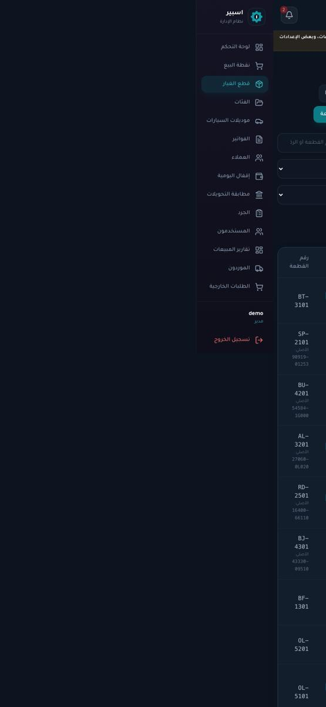
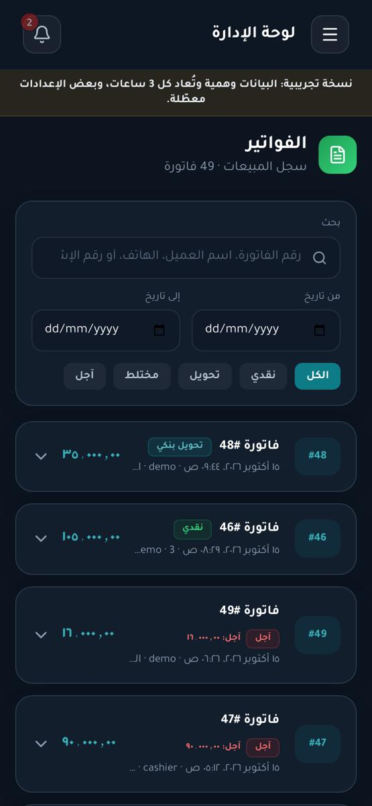

# مراجعة واجهة اسبير على الهاتف

تاريخ الفحص: 15 أكتوبر 2026. الإصدار: `main` عند التزام `befce82`.

## الخلاصة

الواجهة على الهاتف في حال جيدة عموماً: لا يوجد تجاوز أفقي في 15 صفحة إدارة من 17، ولا في الصفحات العامة. لكن ثبت عيب واحد مهم: **صفحتا «قطع الغيار» و«التحويلات» تتسعان أفقياً على الهاتف فتصبح الصفحة كلها قابلة للسحب جانبياً**. وهناك مشاكل أصغر في القائمة الجانبية، وحجم أهداف اللمس، والخطوط الصغيرة.

**لقطتك (صفحة الإعدادات والقائمة الظاهرة جزئياً):** ليست عيباً دائماً. هي لقطة التُقطت أثناء إغلاق القائمة بعد اختيار «إعدادات الموقع» منها (العنصر النشط ظاهر بتظليل أخضر في اللقطة). قست حركة الإغلاق: بعد 60ms تكون القائمة عند `left=286` (تقارب موضعها في لقطتك)، وبعد 260ms تستقر خارج الشاشة تماماً. لكن الحركة كشفت عيباً صغيراً حقيقياً (البند 2).

## الحالة بعد المراجعة

- **البند 1 (التجاوز الأفقي):** أُصلح في الـ PR المرتبط. أُضيف `relative` إلى كل حاويات الجداول القابلة للتمرير (17 حاوية لا اثنتين فقط)، ومعه اختبار يمنع تكرار الخطأ. أُعيد الفحص: **صفر تجاوز في 54 فحصاً** (27 صفحة × عرضين).
- **البند 2 (القائمة الجانبية):** أُصلح. العرض ثابت 256 طوال الحركة، والإخفاء بالإزاحة.
- **البنود 3 و4 و5:** أُصلحت في PR لاحق (أهداف اللمس، والخطوط الصغيرة، واسم العميل في الفواتير). قياس بعد الإصلاح عند 390: **الخطوط الأصغر من 11px صفر في كل الصفحات** (كانت 155 في الدليل و74 في المتجر)، وأهداف اللمس الصغيرة في موديلات السيارات 52 ← 2، وفي الفواتير 7 ← 2، وفي الطلبات 7 ← 2. المتبقي مربعات اختيار بحجم 24px (حد WCAG 2.2) وأزرار المتجر والأرقام الهاتفية الصغيرة.
- **اكتشاف أثناء الإصلاح:** أزرار تعديل الفئات وحذفها كانت `opacity-0` لا تظهر إلا بتمرير الفأرة، أي **غير مرئية على الهاتف**. صارت ظاهرة على اللمس.
- **شاشة التحميل:** الانتقال إلى صفحة لم تُحمَّل بعد كان يستبدل القائمة والترويسة بشاشة تحميل كاملة؛ صار التحميل داخل الإطار.
- **البنود 6–9:** لم تُنفَّذ بعد.

## كيف فُحصت

- Chromium بمحاكاة الهاتف (لمس، `isMobile`، كثافة 2×) على عرضين: **390×844** و**360×740**.
- 17 صفحة إدارة بحساب المدير، منها كل تبويبات الإعدادات الخمسة، و5 صفحات عامة (الرئيسية، المتجر، الدليل، الدخول، تفاصيل منتج).
- لكل صفحة: التجاوز الأفقي، والعناصر الخارجة عن الشاشة، وحجم أهداف اللمس، وأحجام الخطوط، ثم لقطات.
- بيانات العرض التجريبية، على نسخة محلية من الكود.

## الملاحظات مرتبة بالأولوية

### 1. تجاوز أفقي لكامل الصفحة في «قطع الغيار» و«التحويلات» — أولوية عالية

| الصفحة | التجاوز عند 390 | عند 360 |
|---|---|---|
| قطع الغيار (`/spare-parts`) | 648px | 678px |
| مطابقة التحويلات (`/dashboard/transfers`) | 413px | 443px |

**الأثر:** يتسع عرض الصفحة إلى 1038px و803px، فتخرج الترويسة وزر القائمة وعنوان الصفحة عن الشاشة، وتصبح الصفحة قابلة للسحب يمنة ويسرة، وتظهر القائمة المغلقة عند السحب. هذه أقرب حالة لما يراه المستخدم من «تضرر التخطيط» على هاتفه.

**السبب (مثبت بالتجربة):** عناصر `sr-only` (نص مخفي بصرياً لقارئ الشاشة، مثل «(منخفض)» و«إجراءات») داخل الجدولين. هذه العناصر `position: absolute`، فلا يقصّها `overflow-x-auto` الخاص بحاوية الجدول لأنها ليست `relative`. فتبقى في موضعها الأفقي خلف الجدول العريض (1301px في قطع الغيار، 920px في التحويلات) وتوسّع الصفحة. الجدولان نفسهما محتويان ويتمرران جيداً.

**التحقق:** بتجربة مباشرة، جعل حاوية الجدول `position: relative` صفّر التجاوز في الصفحتين (648 ← 0، 413 ← 0).

**الإصلاح:** إضافة `relative` إلى `div.overflow-x-auto` المحيط بالجدولين ([SpareParts.jsx:417](frontend/src/pages/SpareParts.jsx:417) و[Transfers.jsx:358](frontend/src/pages/Transfers.jsx:358)). والأفضل مكوّن مشترك للجداول يفعل ذلك، حتى لا يتكرر في أي جدول جديد.

### 2. القائمة الجانبية: عرضها يقفز لحظة الإغلاق — أولوية متوسطة

العرض `w-64` (256px) مضاف فقط عندما تكون القائمة مفتوحة ([Sidebar.jsx](frontend/src/components/Sidebar.jsx)). فعند الإغلاق يتحول عرضها فوراً إلى عرض محتواها (185px) وتبدأ الانزلاق في الوقت نفسه، فتبدو القائمة وكأنها تنكمش ثم تنزلق.

القياس: مفتوحة `w=256`، بعد 60ms من الإغلاق `w=185`، واستقرارها خارج الشاشة بعد نحو 260ms.

**الإصلاح:** `w-64` ثابتة، والإخفاء بـ `translate-x` بدل `right` السالب. ويُضاف `prefers-reduced-motion` لإلغاء الحركة لمن يفضل ذلك. (القائمة المغلقة صارت `inert` ولا تتلقى تركيز لوحة المفاتيح، وهذا يعمل.)

### 3. أهداف اللمس أصغر من المناسب — أولوية متوسطة

أصغر من 40px في أحد البعدين: قطع الغيار 98 من 108 عنصراً، موديلات السيارات 52 من 56، العملاء 26 من 34، الفئات 12 من 15.

أمثلة: مربعات الاختيار في جدول القطع **16×16px**، وأزرار التعديل والحذف في الفئات والموديلات 28–32px، وأزرار تصفية الفواتير والعملاء وفترات التقارير بارتفاع 28px.

للمرجع: WCAG 2.2 يشترط 24×24 كحد أدنى (مربع الاختيار 16×16 لا يحققه)، وApple تنصح بـ 44، وMaterial بـ 48. المحل الذي يبيع يعمل بيد واحدة وقد تكون متسخة.

**الإصلاح:** رفع مساحة اللمس (padding أو `min-h-11 min-w-11`) دون تكبير الشكل، خصوصاً مربعات الاختيار وأزرار الصفوف وأزرار التصفية.

### 4. خطوط صغيرة جداً — أولوية متوسطة

عدد العناصر النصية بحجم 11px فأقل عند 390:

| الصفحة | ملاحظة |
|---|---|
| الدليل `/shop` | 28 عنصراً بحجم **8px**، و30 بحجم 9px، و96 بحجم 10px (شارات السيارات المتوافقة 8px) |
| المتجر `/store` | 74 عنصراً بحجم 10px أو أقل |
| الفواتير | 31 عنصراً بحجم 10px |
| العملاء | 21 عنصراً بحجم 10px |

الحد الأدنى المريح للقراءة نحو 12px، والمهم منها (حالة القطعة، السعر، الشارات) 13px فأكثر.

### 5. قائمة الفواتير: اقتطاع النص من الجهة الخطأ — أولوية متوسطة

السطر الفرعي لكل فاتورة («التاريخ · الكاشير · العميل») يُقتطع بنقاط من الطرف الخطأ في الاتجاه من اليمين لليسار، فيظهر «…emo · 3 ص ٠٨:٢٩» ويضيع اسم العميل. اسم العميل أهم ما يبحث عنه من يتصفح الفواتير.

**الإصلاح:** وضع العميل في سطر مستقل بقص صحيح، أو تقصير الكاشير أولاً.

### 6. جداول عريضة بلا إشارة للتمرير — أولوية متوسطة

جدول القطع (1301px) وجدول التحويلات (920px) يتمرران أفقياً بلا أي إشارة بصرية (تلاشٍ على الحافة، أو عمود أول ثابت)، فلا يعرف المستخدم أن هناك أعمدة أخرى. بينما الفواتير والعملاء تُعرض كبطاقات على الهاتف، وهذا أنسب.

**الإصلاح:** بطاقات للصفوف على الشاشات الصغيرة، أو عمود اسم القطعة ثابت (`sticky`) مع تلاشٍ على الحافة.

### 7. شريط «نسخة تجريبية» — أولوية منخفضة

يشغل سطرين (نحو 50px) أعلى كل صفحة ولا يُغلق، على شاشة ارتفاعها 844px. **الإصلاح:** سطر واحد أقصر (مثلاً «نسخة تجريبية — البيانات وهمية»)، أو زر إغلاق يحفظ اختياره للجلسة.

### 8. هوامش المناطق الآمنة (Safe Area) — أولوية منخفضة

الترويسة `viewport-fit=cover` تفعّل رسم الصفحة تحت الشق وشريط الإيماءات، لكن `env(safe-area-inset-*)` مستخدم في صفحة نقطة البيع وحدها. أي عنصر ثابت في أسفل الشاشة في صفحات أخرى قد يلامس شريط الإيماءات على iPhone وبعض أجهزة Android. لم يُتحقق منه على جهاز حقيقي.

### 9. تفاصيل صغيرة

- حقول التاريخ تعرض «dd/mm/yyyy» وحقل رفع الشعار «No file chosen / Choose File» بالإنجليزية، لأنها تتبع لغة المتصفح لا لغة الصفحة.
- بطاقات المتجر بلا صور تعرض مساحة بديلة كبيرة (192px)، فتأخذ البطاقة قرابة شاشة كاملة. تقليلها عند غياب الصورة يعرض عدداً أكبر من القطع.

## ما يعمل جيداً

- لا تجاوز أفقي في 15 صفحة إدارة، وكل تبويبات الإعدادات الخمسة، والصفحات العامة، على 390 و360.
- سلة نقطة البيع، ولوحة التحكم، والإقفال، والتقارير، والطلبات، تُعرض بوضوح.
- الصفحة التسويقية تتكيف جيداً، وتظهر لقطة الهاتف بدل لقطة الكمبيوتر.
- القائمة المغلقة خارج التنقل بلوحة المفاتيح وقارئ الشاشة، وللأزرار أسماء.
- لا أخطاء JavaScript في الصفحات المفحوصة.

## ما لم يُفحص

- أجهزة حقيقية: iOS Safari وAndroid Chrome (الفحص بمحاكاة Chromium فقط). سلوك لوحة المفاتيح الافتراضية مع شريط الإجمالي الثابت في نقطة البيع، وسلوك السحب من حافة الشاشة.
- الوضع الأفقي، وتكبير الخط من إعدادات النظام.
- كاميرا مسح الباركود، والطباعة، والشبكات البطيئة جداً.
- حسابات الكاشير والمشرف (فُحص حساب المدير).

## الترتيب المقترح للتنفيذ

1. **البند 1** (سطران وتحقق)، وهو الأهم.
2. **البند 2** (القائمة الجانبية) و**البند 5** (الفواتير).
3. **البندان 3 و4**: أهداف اللمس والخطوط، وهما الأوسع أثراً على راحة الاستخدام اليومي، ويحتاجان مراجعة بصرية.
4. **البند 6** (الجداول)، ثم البنود 7–9.
